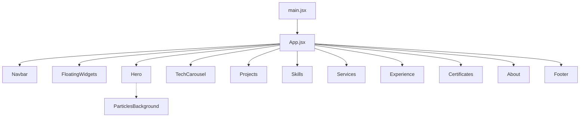

<div align="center">
  
  <h1>Portafolio Interactivo</h1>
  <p><b>Portafolio personal de una sola página en React: presentación, proyectos, habilidades, servicios, experiencia y certificados, con tema oscuro neón y animaciones.</b></p>
  
  
  
  
  
  
  <p>
    <a href="#-inicio-rápido">Inicio rápido</a> ·
    <a href="#-características">Características</a> ·
    <a href="#-arquitectura">Arquitectura</a> ·
    <a href="#-pruebas">Pruebas</a> ·
    <a href="#-lo-que-todavía-no-existe">Limitaciones</a>
  </p>
</div>

Sitio estático (SPA) construido con React, Vite y Tailwind. Toda la información está escrita directamente en los componentes: **no hay backend, base de datos ni CMS**. El «asistente IA» del sitio es un conjunto de respuestas predefinidas, no un modelo de lenguaje.

## 🎬 Vista rápida

No se incluyen capturas: la portada muestra una fotografía y datos personales reales. El recorrido de la página es:

```text
Navbar (Inicio · Proyectos · Habilidades · Servicios · Experiencia · Certificados · Sobre mí, tema claro/oscuro, botón «Descargar CV»)
  └─ Hero ............ presentación, redes sociales, botones «Ver mi trabajo» / «Certificados»
  └─ TechCarousel .... carrusel de tecnologías
  └─ Projects ........ galería filtrable por categoría (SaaS, Full Stack, Frontend, Backend, Mobile)
  └─ Skills .......... habilidades por categoría con iconos
  └─ Services ........ servicios ofrecidos
  └─ Experience ...... trayectoria
  └─ Certificates .... certificados
  └─ About ........... sobre mí
Widgets flotantes: atajo a WhatsApp + chat con respuestas predefinidas
```

## ✨ Características

| Característica | Detalle |
|---|---|
| Secciones | 8 componentes de sección en `src/components/` orquestados desde `src/App.jsx` |
| Animaciones | `framer-motion`, tarjetas con inclinación (`react-parallax-tilt`) y fondo de partículas (`@tsparticles`) |
| Tema | Interruptor claro/oscuro en la barra de navegación (estado local del componente `Navbar`) |
| Proyectos | 30 tarjetas con filtro por categoría (ver [limitaciones](#-lo-que-todavía-no-existe)) |
| Widgets flotantes | Botón de WhatsApp y chat con reglas por palabras clave (sin llamadas a ninguna API) |
| Descarga de CV | Botón que apunta a `pdf/CurriculumLuis.pdf` |
| Despliegue | Workflow de GitHub Actions que compila y publica en GitHub Pages en cada push a `main` |

## 🏗️ Arquitectura



<details>
<summary>Estructura de carpetas</summary>

```text
.github/workflows/deploy.yml   # build + publicación en GitHub Pages
src/
  App.jsx, main.jsx, index.css
  components/                  # Hero, Projects, Skills, Services, Experience, Certificates, About, ...
  public/img/                  # imágenes usadas por los componentes
pdf/                           # currículum en PDF
dist/index.html                # salida de build comprometida en el repo
vite.config.js                 # base '/portafolio/' para GitHub Pages
tailwind.config.js             # paleta neón (cyan-glow, deep-black, ...)
```

</details>

## 🚀 Inicio rápido

| Requisito | Versión |
|---|---|
| Node.js | 20 en CI (probado también con Node 24) |
| npm | el incluido con Node |

```bash
npm install
npm run dev        # servidor de desarrollo (Vite); abre http://localhost:5173/portafolio/
npm run build      # genera dist/ (verificado: compila correctamente)
npm run preview    # sirve el build
```

La ruta base es `/portafolio/` (configurada en `vite.config.js` para GitHub Pages), así que en local la URL incluye ese prefijo.

## 🧪 Pruebas

No hay tests automatizados. El script `npm run lint` existe en `package.json`, pero el proyecto no declara ESLint ni tiene configuración, por lo que hoy no es utilizable. La única verificación automática es que `npm run build` compile en el workflow de despliegue.

## 🔒 Seguridad

Al ser un sitio estático no maneja secretos ni sesiones. Aviso de privacidad: el nombre, contacto y respuestas del asistente están escritos en el código fuente y quedan públicos al desplegar.

## 🚧 Lo que todavía no existe

- **Los proyectos de la galería son datos de ejemplo**: títulos, estrellas, forks, ramas y fechas («hace 2 días») están escritos a mano en `Projects.jsx`, y todos los enlaces de repositorio y demo apuntan a `#`. No representan repositorios reales.
- **El asistente IA no usa IA**: responde por coincidencia de palabras clave.
- **Botón «Descargar CV»**: usa `BASE_URL + pdf/CurriculumLuis.pdf`, pero el PDF vive en `pdf/` en la raíz y no en `public/`, así que Vite no lo copia al build; el enlace probablemente falle en la versión publicada (no verificado en producción).
- Sin ESLint configurado, sin tests, sin formulario de contacto funcional.
- `dist/index.html` está comprometido aunque es un artefacto de build.

## 📄 Licencia

Sin licencia definida: todos los derechos reservados por defecto.

<div align="center"><sub>Hecho por Luiss2080 · React + Vite + Tailwind</sub></div>
